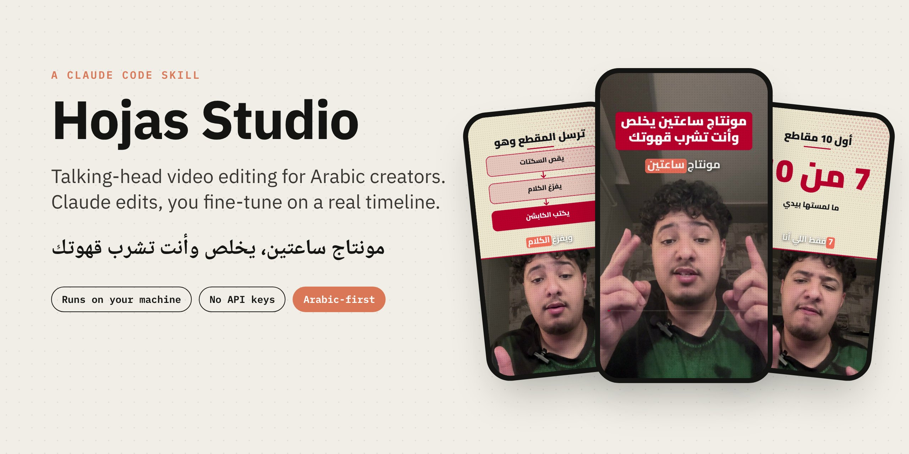
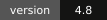
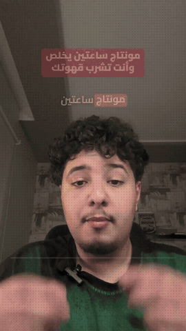
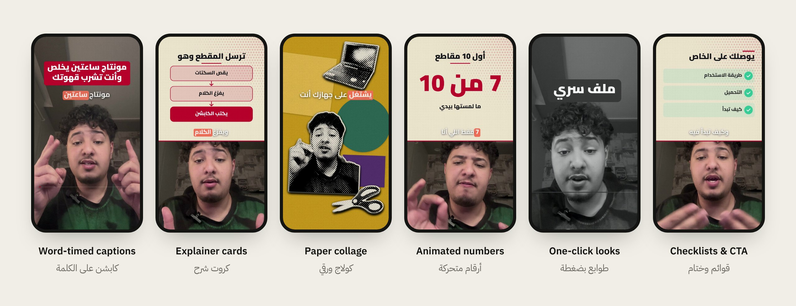
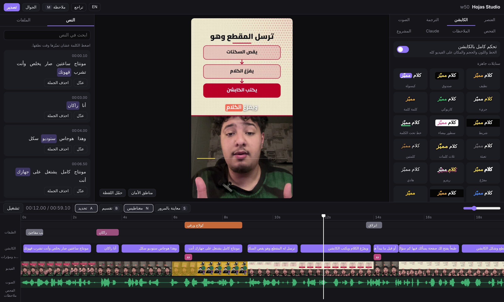
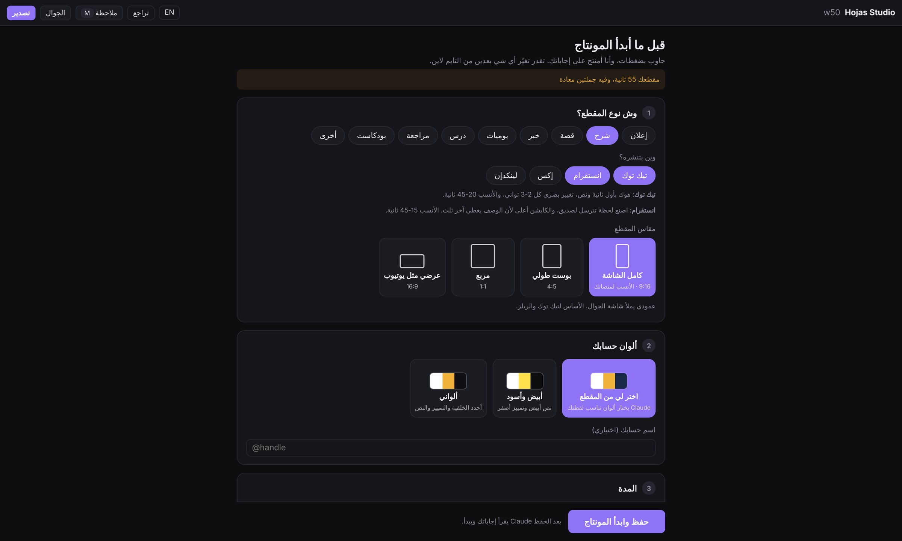
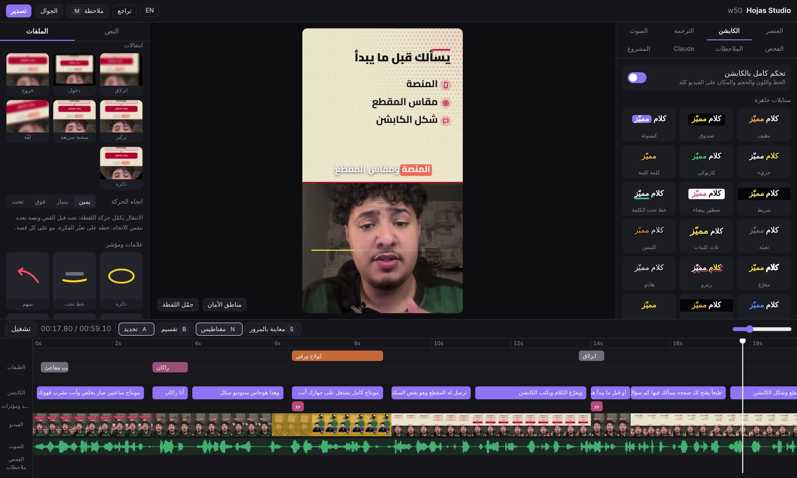
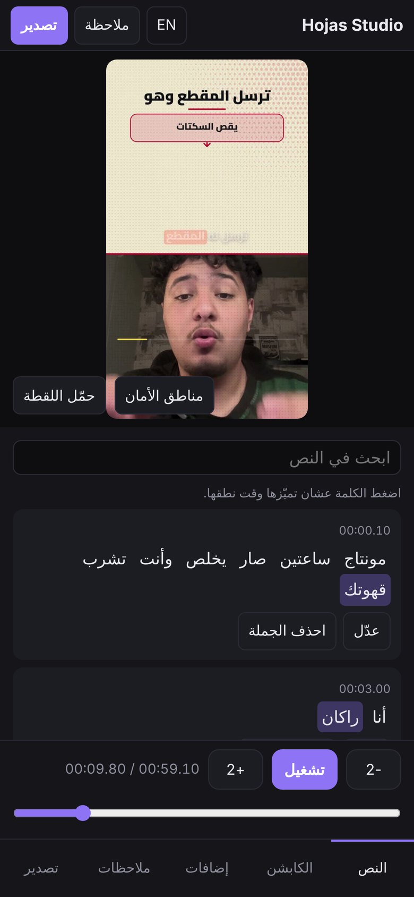

<p align="center">
  
</p>

<p align="center">
  <a href="README.ar.md"><b>العربية</b></a> ·
  <a href="#quick-start">Quick start</a> ·
  <a href="#what-you-get">Features</a> ·
  <a href="GUIDE.html">Full guide</a> ·
  <a href="docs/assets/demo.mp4">Demo video</a>
</p>

<p align="center">
  
  
  
  
</p>

**Hojas Studio** is a [Claude Code](https://docs.claude.com/en/docs/claude-code/overview) skill that edits talking-head videos the way a good editor would, and then hands you the edit on a real timeline in your browser.

Give Claude a clip. It cuts the silences, transcribes every word, writes word-timed Arabic captions, asks you a few questions on a page (platform, aspect ratio, caption style), designs explainer cards, adds b-roll and sound, and opens the result on a timeline where you change anything you want before exporting.

Everything runs on your computer. No API keys, no uploads.

<table>
<tr>
<td width="34%" align="center"><br><sub>This clip was edited with Hojas Studio. <a href="docs/assets/demo.mp4">Watch the full 60 s</a></sub></td>
<td>

### Why it exists

Editing a 60-second Arabic short by hand takes hours: cutting pauses, typing captions word by word, keeping text out of the platform's UI, rebuilding the same explainer cards every time.

Hojas Studio turns that into a conversation. Claude does the heavy edit, and you keep full control: every caption, card, effect and cut sits on a timeline you can drag, trim and restyle, with live preview and no re-render.

**Made for creators who post on TikTok, Instagram Reels, X and LinkedIn**, with each platform's safe zones, length and pacing built in.

</td>
</tr>
</table>

## What you get

<p align="center"></p>

| | |
|---|---|
| **Smart cut** | Removes silences, filler words and repeated takes, then keeps cuts on sentence boundaries. |
| **Arabic captions** | Word-timed, grouped on breathing pauses, 20 ready styles, highlight on the spoken word, optional English translation line. |
| **Questions page** | Before editing, Claude opens a page to ask about type, platforms, aspect ratio, captions, cards, music and ending. No back-and-forth in chat. |
| **Explainer cards** | Steps, flows, comparisons, checklists, timelines, quotes, big numbers and free-form diagrams, placed above your face, never on it. |
| **Motion & numbers** | Counters, slot numbers, dot percentages, bar and line charts, route maps and highlighted headlines. |
| **Transitions & marks** | Seven motion-matched transitions, hand-drawn circles and arrows, a clicking cursor and lower thirds. |
| **Looks & grading** | 12 one-click looks (dossier, keynote, riso, blueprint, mashrabiya and more) and 11 color grades. |
| **You and your background** | Blur or replace what is behind you, or slide a word behind your head. Segmentation runs in the browser on your machine. |
| **Sound** | A 30-sound library, your own sounds and music, voice clean-up presets and automatic ducking under speech. |
| **Exports** | 9:16 master plus 4:5, 1:1 or 16:9 versions, hook variants and a clean no-caption copy, with a post caption written for each platform. |

## The studio

<p align="center"></p>

The timeline opens in your browser while Claude works. Layers, captions, sound and video each have their own track. Click a sentence to edit it, drag a card to retime it, pick a caption style and see it instantly. Leave a note on any second and Claude applies it.

<table>
<tr>
<td width="50%"><br><sub><b>Questions page.</b> You answer once, Claude edits to your platform.</sub></td>
<td width="50%"><br><sub><b>Tools.</b> Transitions, marks, looks and cards as live previews.</sub></td>
</tr>
</table>

<p align="center"><br><sub>Scan a QR code and review or tweak the edit from your phone.</sub></p>

## Quick start

1. Install [Claude Code](https://docs.claude.com/en/docs/claude-code/overview) and sign in.
2. Download this repository (**Code → Download ZIP**) and unzip it somewhere permanent, such as `Documents`.
3. Run the installer:
   - **Windows:** double-click `install.bat`
   - **macOS / Linux:** `bash install.sh`
4. Restart Claude Code and type:

   ```
   Check the Hojas Studio tools
   ```

   Claude lists what is missing (ffmpeg, Python with Whisper, Node, Chrome, and Git for Windows on Windows), explains why each is needed and where it comes from, and installs nothing without your approval.
5. Then just ask:

   ```
   Edit this clip for TikTok: C:\Users\you\Videos\clip.mp4
   ```

The full A to Z guide, with every tool explained, is in [`GUIDE.html`](GUIDE.html) (also as [`GUIDE.pdf`](GUIDE.pdf)).

## Requirements

| Tool | Why | Size |
|---|---|---|
| Claude Code | Runs the skill | |
| ffmpeg | Cuts, mixes and encodes the video | about 90 MB |
| Python + Whisper | Transcribes speech with per-word timing, locally | model about 1.4 GB, once |
| Node.js | Drives headless Chrome to render captions and cards | |
| Chrome or Edge | The renderer, the browser you already have | |
| Git for Windows | Windows only, runs the shell scripts | |

## Privacy and security

- Video, audio and transcripts never leave your computer.
- No API keys anywhere. Optional AI images or clips are generated with **your own** ChatGPT or Gemini account in your browser, only when you ask.
- The studio is reachable on your local network so your phone can open it, protected by an access code. Ten wrong codes from one device lock it for 15 minutes. Do not run it on public Wi-Fi.
- What touches the internet: Google Fonts, the Mixkit sound library on first use, and Wikimedia image search when you ask for it. `python hs.py tools` lists it all.

## Command line

Claude runs these for you, but they are there if you want them:

```bash
python hs.py doctor              # check the tools
python hs.py open <project>      # open the studio for a project
python hs.py tools               # what each tool is for, and what goes online
python hs.py selftest            # self-check of the studio files
```

## Project layout

```
SKILL.md          instructions Claude follows
hs.py             studio server and commands
studio.html       timeline UI (with app.js, i18n.js: Arabic and English)
ext.js            renderer extension: captions, layers, transitions, looks
engine/           cutting, transcription, rendering and export pipeline
GUIDE.html        full user guide
```

## FAQ

**Does it need an API key or a paid service?** No. It runs on Claude Code with your own account, and everything else is free and open source.

**Is it only for Arabic?** It is built Arabic-first (right-to-left captions, Arabic fonts, Saudi-friendly defaults). The interface also has an English mode, and it can add an English translation line under the captions.

**Can I use it for client work or sell it?** The license allows free personal and noncommercial use. For commercial use, open an issue to get permission.

## Credits

Made by **Hojas** (Rakan Alzahrani).
Ideas and components from HyperFrames, lemo-opuscar, gbro-collage-broll, MediaPipe and qr.js are credited with their licenses in [`THIRD_PARTY.md`](THIRD_PARTY.md) and [`LICENSES/`](LICENSES).

## License

[PolyForm Noncommercial 1.0.0](LICENSE). Free for personal and noncommercial use. Commercial use needs written permission from the author.
